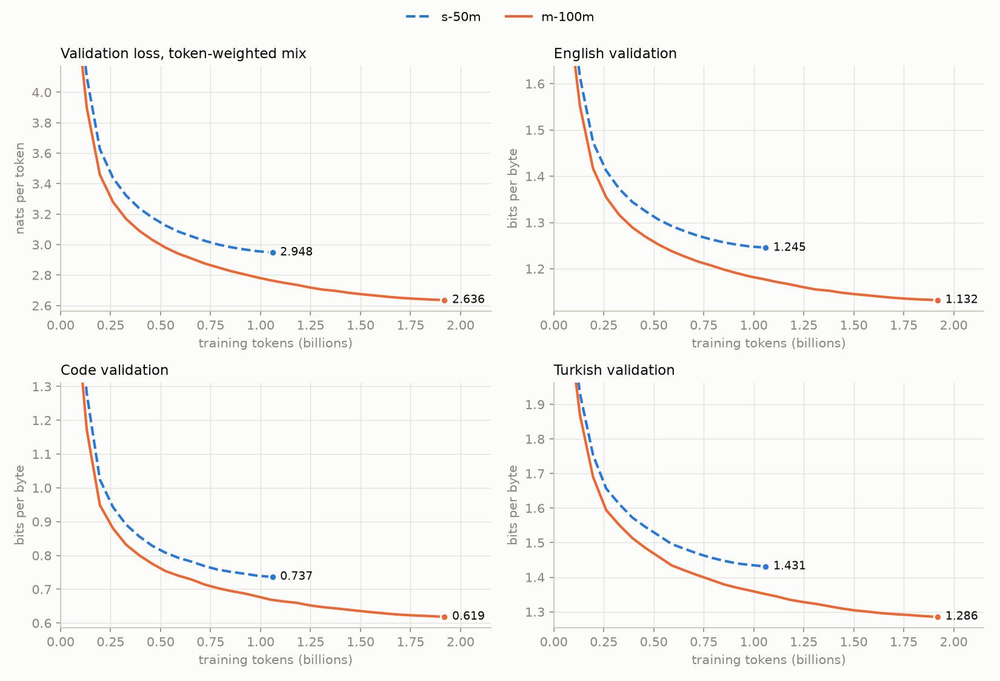

# GLM Ladder From Scratch

A family of GLM-5.3-Flash-inspired mixture-of-experts language models at 25M, 50M, 100M, and 200M parameters, pretrained from random initialization, post-trained, fine-tuned, and improved with reinforcement learning, entirely on Google Colab GPUs.

This project extends [vukrosic/glm-5.3-flash-from-scratch](https://github.com/vukrosic/glm-5.3-flash-from-scratch), which showed that executable-reward RL can teach a 25.7M model narrow coding behaviors. The central question here is what happens to that result as the model grows.

> **Status: Phase 2 (pretraining) complete for `s-50m` and `m-100m`.** Both models are trained to 20 tokens per parameter; results are [below](#pretraining-results). `baseline-25m` reproduction and `l-200m` are deferred until SFT, fine-tuning, and RL are done on the two trained rungs. Every number in this README comes from a receipt in [`artifacts/receipts/`](artifacts/receipts/) unless it is labeled as an estimate.

## Research question

> With the architecture, training pipeline, and evaluation protocol held fixed, how do the gains from executable-reward reinforcement learning change from 25M to 200M parameters, and does RL interference on untrained task families shrink or grow with scale?

Secondary questions, each run as a controlled ablation:

- Does a working MoE load-balancing loss change pretraining quality? (The original's balance loss had no gradient; see below.)
- Byte-level versus BPE tokenization at equal compute.
- RLOO versus GRPO versus DPO under a matched rollout budget.
- Full fine-tuning versus LoRA on the same downstream task.

## The ladder

All rungs keep the original rhythm: three linear-attention blocks then one sparse-attention block, 8 routed experts with top-2 routing plus one shared expert, and four residual streams. Only width, depth, vocabulary, and context change.

| Rung | Width × layers | Heads | Total params | Active params/token | Tokenizer | Context |
|---|---:|---:|---:|---:|---|---:|
| `baseline-25m` | 192 × 12 | 6 | 25,730,592 | 9,805,344 | bytes (260) | 192 |
| `s-50m` | 384 × 12 | 6 | 53,229,024 | 26,686,944 | BPE (16,384) | 1024 |
| `m-100m` | 512 × 16 | 8 | 96,027,264 | 48,841,344 | BPE (16,384) | 1024 |
| `l-200m` | 640 × 18 | 10 | 199,345,424 | 93,177,104 | BPE (16,384) | 1024 |

Parameter counts come from the closed-form formula in [`glm_ladder/config.py`](glm_ladder/config.py) and are checked against the PyTorch modules by the test suite. The baseline row is identical to the original repository.

## What changed from the original model

The rewritten model keeps the original parameter names, so original checkpoints load without conversion. A parity test loads the original model's weights into the new one and requires the same logits.

| Issue in the original | Effect | Fix |
|---|---|---|
| Expert usage computed from integer counts | The router balance loss had **zero gradient** and did nothing | Switch Transformer auxiliary loss (routed fraction × mean router probability); a test shows the router now receives gradient and the original did not |
| Linear attention stored a d × d state per position | Memory grows as batch × time × heads × d², which does not fit at 1024 tokens and 200M parameters | Chunked linear attention: one state per chunk, identical output (tested against the original formula in float64) |
| Sparse attention rebuilt gather indices with Python loops every forward pass | CPU-bound at long context | Cached boolean mask with PyTorch's fused attention kernel; the mask is tested position-by-position against the original pattern |
| Linear-attention prefix sums ran in bf16 under autocast | Precision loss over long prefixes | Attention core runs in float32 |
| Uniform 0.02 initialization at every depth | Residual variance grows with depth | Optional GPT-2 style scaled init of residual projections (on for ladder rungs, off for the baseline) |

The sparse layers still compute a full masked score matrix. At 1024 tokens that is fast, but it is not a sub-quadratic kernel.

## Tokenizer

A 16,384-token byte-level BPE (Hugging Face `tokenizers`, GPT-2 pre-tokenization) trained on a
200 MB sample with the same mix as the pretraining data: 60% English (FineWeb-Edu),
30% Python (codeparrot-clean), 10% Turkish (FineWeb2-HQ). Ids fit in uint16.
Sixteen special tokens are reserved up front (document separator, padding, chat roles,
ten spares) because the vocabulary cannot change after pretraining.

Held-out compression (UTF-8 bytes per token; higher is better; the original byte tokenizer scores 1.0):

| Text | With 10% Turkish | Same English + code, no Turkish |
|---|---:|---:|
| English | 4.103 | 4.169 |
| Python | 3.468 | 3.513 |
| Turkish | **3.507** | 1.943 |

Adding 10% Turkish to the tokenizer sample makes Turkish text 1.8× shorter in tokens,
at a cost of 1.6% on English and 1.3% on Python. Both tokenizers saw identical English and
code documents, so the difference is attributable to the Turkish data.

Known limitation: GPT-2 pre-tokenization keeps digit runs together (305 number tokens,
up to 8 digits), which makes arithmetic harder than digit-split schemes.

Receipt: [`artifacts/receipts/tokenizer-16k.json`](artifacts/receipts/tokenizer-16k.json).
Reproduce: `python scripts/train_tokenizer.py --compare-without-turkish`.

## Pretraining corpus

2.2B tokens, tokenized once on a Colab CPU runtime and stored as uint16 shards (100M tokens each, cut on document boundaries) in a private Hugging Face dataset repository. Every shard's SHA-256 is recorded in a per-source manifest and checked before training.

| Source | Train tokens | Validation tokens | Mix weight (tokens) |
|---|---:|---:|---:|
| English (FineWeb-Edu `sample-10BT`) | 1,200,008,673 | 10,006,579 | 0.560 |
| Python (codeparrot-clean) | 700,033,862 | 10,003,441 | 0.331 |
| Turkish (FineWeb2-HQ `tur_Latn`) | 300,008,360 | 10,003,016 | 0.109 |

The mix is defined in bytes (60 / 30 / 10) and converted to token weights with the tokenizer's measured bytes per token. Each training sequence is drawn from one source with these probabilities, in a seeded order that is fully determined by the step number, so a resumed run sees exactly the data an uninterrupted run would. Neither run completes an epoch of any source.

Receipt: [`artifacts/receipts/corpus-manifest.json`](artifacts/receipts/corpus-manifest.json).

## Pretraining results

Both rungs use the same recipe; only the model and the token budget (20 tokens per parameter) change.

| Setting | Value |
|---|---|
| Batch | 256 sequences × 1024 tokens = 262,144 tokens per step |
| Optimizer | AdamW, β = (0.9, 0.95), weight decay 0.1 on matrices only, gradient clip 1.0 |
| Learning rate | 6e-4, 100 warmup steps, cosine decay to 6e-5 |
| MoE balance loss | coefficient 0.01 |
| Precision | bf16 autocast, float32 linear-attention core, TF32, `torch.compile` |
| Hardware | one A100 40 GB (Colab Pro) |

| | `s-50m` | `m-100m` |
|---|---:|---:|
| Total / active parameters | 53.2M / 26.7M | 96.0M / 48.8M |
| Training tokens | 1.06B | 1.92B |
| Steps | 4,044 | 7,325 |
| Training time (A100) | 1.77 h | 5.35 h |
| Mean throughput | 166,499 tok/s | 99,714 tok/s |
| **Validation loss, mixed** (nats/token) | 2.948 | **2.636** |
| English (nats/token) | 3.541 | 3.220 |
| Python | 1.771 | 1.488 |
| Turkish | 3.479 | 3.126 |

Losses per token are not comparable across languages, because a token covers a different amount of text in each. Dividing by ln 2 and by the tokenizer's bytes per token gives **bits per UTF-8 byte**, which is:

| Bits per byte | `s-50m` | `m-100m` | Relative gain |
|---|---:|---:|---:|
| English | 1.245 | 1.132 | 9.1% |
| Python | 0.737 | 0.619 | **16.0%** |
| Turkish | 1.431 | 1.286 | 10.2% |



What the numbers show:

- **Python gains the most from scale**, relative to its starting point. Code has long-range structure (definitions used far later, nested blocks) that a larger model captures better.
- **Turkish is the hardest source per byte** for both models, and gains slightly more than English. It is 11% of the training tokens and morphologically rich.
- **Model size and data grew together** (1.8× each), so the gap is the effect of compute-optimal scaling, not of size alone. One matched-token point exists: at 1.05B tokens, mid-schedule and with its learning rate still high, `m-100m` was at 2.766 against `s-50m`'s final 2.948.
- **Diminishing returns:** 3× the GPU time bought 0.31 nats.
- **Initial loss** was 9.87 for `s-50m` and 10.67 for `m-100m`, above ln(16,384) = 9.70. With tied embeddings and near-zero blocks at initialization, the output logit of the *input* token is about 0.02 × width, so the model starts out predicting "the same token again" with probability 12% (`s-50m`) or 62% (`m-100m`). This accounts for both values and disappears within ~10 steps.

Receipts: [`pretrain-s50m-001.json`](artifacts/receipts/pretrain-s50m-001.json), [`pretrain-m100m-001.json`](artifacts/receipts/pretrain-m100m-001.json). Plot: `python scripts/plot_pretraining.py --runs s50m-001 m100m-001`.

### Samples

Same prompt, seed 0, temperature 0.8, top-k 50, 80 new tokens. The prompt is in `[[ ]]`. One sample per prompt is anecdotal; the validation loss above is the measurement. All samples: [`artifacts/samples/`](artifacts/samples/).

| | `s-50m` | `m-100m` |
|---|---|---|
| English | `[[Photosynthesis is the process by which]] the molecules (does and dyes begin producing their own cells) of proteins. When all in a molecule goes through a process called the cell, it gets made up of RNA (the molecule) and then it is called the cell.` | `[[Photosynthesis is the process by which]] the molecules (or the cell) receive and store energy. To keep up the work of producing energy, the cell is made to continue to grow, to provide energy for the plant.` |
| Turkish | `[[Yapay zeka, günümüzde]] yer alan üçgende yer alan buz, buz, deniz ve deniz kapakları ile diğer bir yerden yapılmış ve en çok kullanılan bir gaban.` | `[[Yapay zeka, günümüzde]] hala aynı teknolojinin en yaygın yaygın kullanımıyla ilgili olmakla birlikte, zeka bilimleri uzmanları, bilişsel ve zihinsel gelişimlerinin, özellikle de bu teknolojinin gelişmesini amaçlayan teknolojinin…` |

Both models write fluent-looking text with no reliable facts and fall into repetition loops. The visible difference is topical coherence: `s-50m` drifts away from the prompt within a sentence (artificial intelligence → ice and seas), while `m-100m` stays on topic for a paragraph. In Python both produce correctly indented, syntactically plausible code without working logic.

A practical note on prompts: ending a code prompt with `"\n"` made `s-50m` drop the indentation, because newline plus indentation is usually a single BPE token, and a prompt that ends on a bare `"\n"` forces a token boundary the model rarely saw. Without the trailing newline both models indent correctly.

### Engineering notes from the runs

- **Resume is bit-exact on the GPU.** A run killed at step ~990 and resumed from its step-942 checkpoint logged loss 3.4936 and gradient norm 0.31 at step 950, identical to the uninterrupted run; the CPU test suite checks the same property on final weights.
- **`torch.compile` and data-dependent shapes.** When the router sends no token of a micro-batch to some expert, the compiled kernel for that expert receives a zero-sized input and fails with `ZeroDivisionError`. Every expert now also processes one zero row with weight 0, which leaves outputs and gradients unchanged.
- **`forward or model` on a compiled module** calls `len()` on the wrapper and raises `TypeError`; use `model if forward is None else forward`.
- **Stale kernels.** In VS Code + Colab, interrupt did not stop a running cell, and *Restart Kernel* left the old process training on the GPU, which caused an out-of-memory error in the new kernel. The training notebook now kills stale kernels before touching CUDA.

## Plan

| Phase | Work | Exit criterion | Status |
|---|---|---|---|
| 0. Infrastructure | Rewritten model, parity tests, throughput benchmark | Tests pass on Colab; measured tokens/s for every rung | Done |
| 1. Data | BPE tokenizer, mixed English + Python + Turkish corpus, sharded and hashed | Deterministic, resumable data stream | Done |
| 2. Pretraining | S → M; baseline reproduction and L deferred | Loss curves, held-out loss, receipts | Done for S and M |
| 3. Post-training | Supervised fine-tuning on instruction data | Instruction-following eval before vs after | Next |
| 4. Fine-tuning | Full fine-tuning vs LoRA on one task (task to be chosen) | Matched-compute comparison | |
| 5. Reinforcement learning | Reproduce RLOO, then GRPO, DPO, reward and KL ablations at every rung | Locked confirmation-set results with paired statistics | |
| 6. Report | Scaling analysis, negative results, limitations | `REPORT.md` | |

The evaluation protocol follows the original repository: decisions are made on a dev split, a separate confirmation split is opened once, and every comparison reports paired exact tests or bootstrap intervals. Negative results are reported.

## Compute and storage

- **Compute:** Google Colab Pro (L4 and A100), 300 compute units in total. Pretraining both rungs took about 7 hours of training on an A100, roughly 45–50 units including setup, evaluation, and checkpoint uploads (estimate from session hours).
- **Resumable training:** Colab sessions can end at any time. Training state (weights, AdamW moments, RNG, step, data position) is pushed to the Hub every 15–25 minutes, and re-running the notebook resumes from the latest checkpoint with the same data order. The two most recent resume checkpoints and the final weights are kept.
- **Code and receipts:** this GitHub repository.
- **Checkpoints and tokenized data:** a Hugging Face Hub repository (too large for GitHub), saved as `safetensors` with SHA-256 hashes recorded in receipts here.

## Quick start

Notebooks are run from VS Code on a Colab GPU runtime through the Google Colab extension; nothing needs to be opened on the Colab website.

| Notebook | Runtime | What it does |
|---|---|---|
| [`00_setup_smoke_test`](notebooks/00_setup_smoke_test.ipynb) | GPU | Tests, throughput benchmark |
| [`01_tokenize_corpus`](notebooks/01_tokenize_corpus.ipynb) | CPU | Tokenizes the corpus into shards on the Hub (resumable) |
| [`02_pretrain`](notebooks/02_pretrain.ipynb) | A100 | Pretrains one rung; set `RUN` and run all cells (resumable) |

In VS Code: open a notebook, *Select Kernel → Colab → New Colab Server*, pick the runtime, run all cells. The Hugging Face token is typed into a hidden prompt and never stored.

Local CPU tests and tools (Python 3.12):

```bash
conda create -n glm-ladder python=3.12 && conda activate glm-ladder
pip install -r requirements.txt
python -m pytest -q

# Talk to a trained model on CPU (downloads only the weights), rebuild a receipt, plot runs
python scripts/sample.py --run m100m-001 --prompt "def fibonacci(n):"
python scripts/pretrain_receipt.py --run m100m-001
python scripts/plot_pretraining.py --runs s50m-001 m100m-001
```

## Repository map

- [`glm_ladder/config.py`](glm_ladder/config.py): model configuration, ladder presets, closed-form parameter counts.
- [`glm_ladder/model.py`](glm_ladder/model.py): hybrid linear/sparse attention, MoE with shared expert, residual streams.
- [`glm_ladder/benchmark.py`](glm_ladder/benchmark.py): throughput, MFU, and compute-unit estimates per rung.
- [`glm_ladder/toy_bpe.py`](glm_ladder/toy_bpe.py), [`tokenizer.py`](glm_ladder/tokenizer.py): BPE from scratch for learning, and the production tokenizer.
- [`glm_ladder/data_sources.py`](glm_ladder/data_sources.py), [`shards.py`](glm_ladder/shards.py), [`corpus.py`](glm_ladder/corpus.py): streaming sources, uint16 shards, resumable upload to the Hub.
- [`glm_ladder/loader.py`](glm_ladder/loader.py): deterministic, resumable mixed-source batches.
- [`glm_ladder/train.py`](glm_ladder/train.py): one optimizer step with gradient accumulation, LR schedule, AdamW groups.
- [`glm_ladder/checkpoint.py`](glm_ladder/checkpoint.py), [`runs.py`](glm_ladder/runs.py): checkpoints with SHA-256, metrics log, checkpoint store on the Hub.
- [`glm_ladder/evaluation.py`](glm_ladder/evaluation.py): validation loss per source, bits per byte.
- [`glm_ladder/pretrain.py`](glm_ladder/pretrain.py): the pretraining loop with evaluation, checkpoints, and exact resume.
- [`glm_ladder/generate.py`](glm_ladder/generate.py): temperature and top-k sampling.
- [`tests/`](tests/): parity with the original model, kernel equivalence, causality, balance-loss gradient, loader determinism, bit-exact resume of the full training loop.
- [`tests/reference/original_model.py`](tests/reference/original_model.py): copy of the original model, used only by tests.
- [`scripts/`](scripts/): tokenizer training, benchmark, sampling, receipts, plots.
- [`artifacts/`](artifacts/): receipts, samples, plots.
- [`PLAN.md`](PLAN.md): decision log and compute budget.

## Sources

- [vukrosic/glm-5.3-flash-from-scratch](https://github.com/vukrosic/glm-5.3-flash-from-scratch)
- [GLM-5.3-Flash official model card](https://huggingface.co/zai-org/GLM-5.3-Flash)
- [Switch Transformers (Fedus et al., 2021)](https://arxiv.org/abs/2101.03961), load-balancing loss
- [Transformers are RNNs (Katharopoulos et al., 2020)](https://arxiv.org/abs/2006.16236), linear attention

## License

MIT. Builds on vukrosic/glm-5.3-flash-from-scratch (MIT). Independent educational project, not affiliated with Z.ai.
